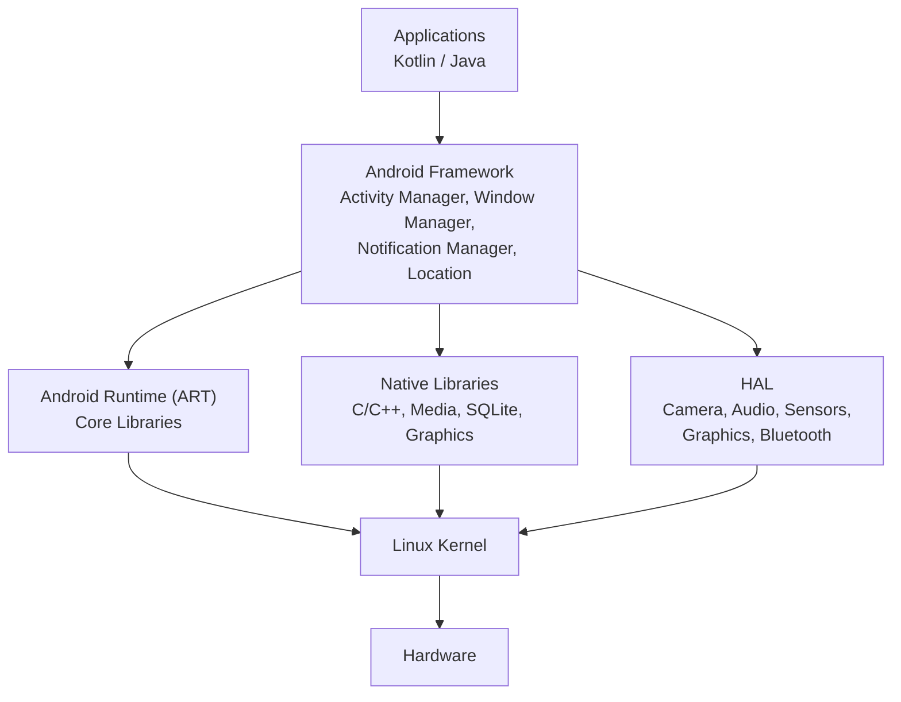
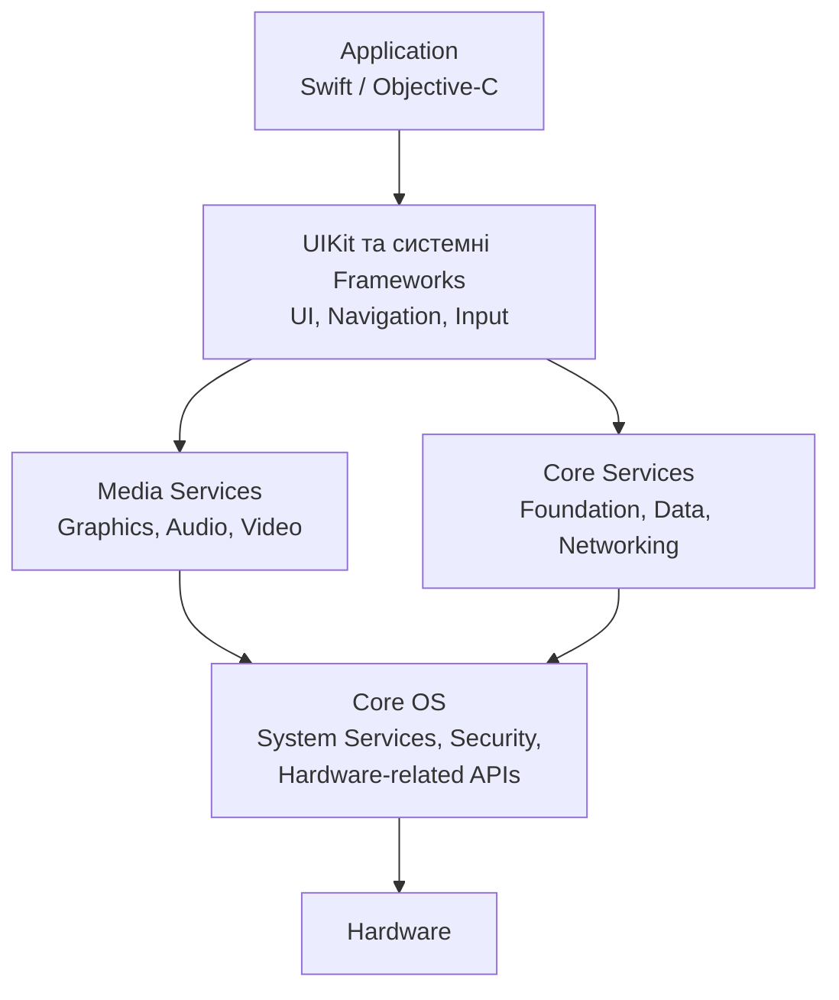
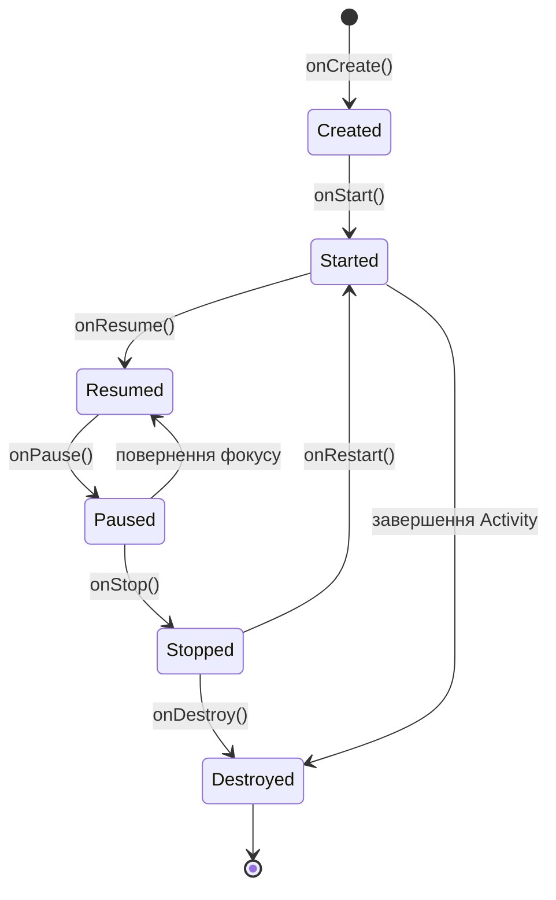
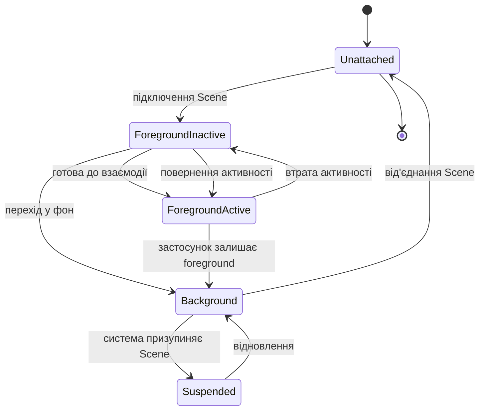

# Practice1.1
# Практична робота 1: Загальний огляд мобільних платформ

**Тема:** Загальний огляд мобільних платформ
**Варіант:** 2 — Архітектурне порівняння Android та iOS

---

## Мета роботи

Дослідити архітектуру платформ Android та iOS, порівняти їхні основні рівні, розглянути життєвий цикл екрана та визначити практичні наслідки архітектурних відмінностей для розробника.

---

# 1. Архітектура Android

Android побудований як багаторівнева програмна платформа. У спрощеному вигляді застосунок взаємодіє з Android Framework, який через системні механізми та HAL забезпечує доступ до функцій операційної системи та апаратного забезпечення. Нижнім рівнем є ядро Linux.

До основних частин Android можна віднести:

* Applications — користувацькі застосунки;
* Android Framework — системні API та менеджери;
* Android Runtime (ART) і native libraries;
* Hardware Abstraction Layer (HAL);
* Linux Kernel.

Android також має систему компонентів застосунку. Основними компонентами є `Activity`, `Service`, `BroadcastReceiver` та `ContentProvider`. Вони оголошуються в `AndroidManifest.xml`.
[Android Developers — App Manifest](https://developer.android.com/guide/topics/manifest/manifest-intro)

## Mermaid-діаграма Android

**Механізм:** застосунок використовує API Android Framework. Коли потрібен доступ до апаратної можливості, відповідна системна підсистема проходить через HAL та нижчі рівні до драйверів ядра. Наприклад, камера Android використовує Camera Framework API, а Camera HAL пов'язує framework з драйвером та апаратним забезпеченням.
[Android Open Source Project — Camera architecture](https://source.android.com/docs/core/camera)

---

# 2. Архітектура iOS

iOS також має багаторівневу архітектуру. Для розробника верхнім рівнем є застосунок, який використовує системні фреймворки Apple.

У практичному представленні можна виділити:

* Application — код конкретного застосунку;
* UIKit та інші системні фреймворки;
* Media Services — графіка, аудіо, відео;
* Core Services — базові системні служби;
* Core OS — низькорівневі механізми операційної системи та робота з апаратними ресурсами.

Apple розділяє функції застосунку та системні сервіси через фреймворки. Наприклад, UIKit відповідає за інтерфейс та взаємодію з життєвим циклом UI.

## Mermaid-діаграма iOS

У сучасному UIKit життєвий цикл інтерфейсу побудований навколо `Scene`. Кожен екземпляр інтерфейсу має власний життєвий цикл, яким керує `UISceneDelegate`.
[Apple Developer — Managing your app's life cycle](https://developer.apple.com/documentation/uikit/managing-your-app-s-life-cycle)

---

# 3. Порівняння архітектури Android та iOS

| Рівень / поняття              | Android                       | iOS                                        | Відповідність                         |
| ----------------------------- | ----------------------------- | ------------------------------------------ | ------------------------------------- |
| Застосунок                    | Application                   | Application                                | Код конкретного застосунку            |
| UI-рівень                     | Android UI / Framework APIs   | UIKit                                      | Створення та керування інтерфейсом    |
| Системні Frameworks           | Android Framework             | Apple Frameworks                           | Доступ до функцій ОС                  |
| Робота з медіа та графікою    | Native Libraries / Frameworks | Media Services                             | Графіка, аудіо, відео                 |
| Системні служби               | Android system services       | Core Services                              | Базові функції ОС                     |
| Низькорівневий рівень         | Linux Kernel                  | Core OS                                    | Системні та апаратні механізми        |
| Робота з hardware             | HAL + drivers                 | System frameworks + OS/hardware interfaces | Абстрагування апаратного забезпечення |
| Основна модель UI-компонентів | Activity, Fragment, View тощо | Scene, UIViewController, UIView            | Керування UI та його станом           |

**Важливо:** це не буквальне зіставлення один-до-одного. Android і iOS мають різну внутрішню реалізацію, тому таблиця показує функціональні відповідності рівнів, а не тотожність компонентів.

---

# 4. Життєвий цикл екрана Android

В Android традиційно основним об'єктом для окремого екрана є `Activity`.

Основні callback-методи:

* `onCreate()` — початкова ініціалізація;
* `onStart()` — Activity стає видимою;
* `onResume()` — Activity виходить на передній план і готова до взаємодії;
* `onPause()` — Activity втрачає передній фокус;
* `onStop()` — Activity більше не видима;
* `onDestroy()` — Activity знищується.

Android також має `onRestart()`, який викликається при поверненні Activity зі стану `Stopped`.

За документацією Android, видимий життєвий цикл Activity знаходиться між `onStart()` та `onStop()`, а період активної взаємодії — між `onResume()` та `onPause()`.
[Android Developers — Activity lifecycle](https://developer.android.com/guide/components/activities/activity-lifecycle)

Спрощена схема:

---

# 5. Життєвий цикл екрана iOS

У сучасному iOS застосунок з UI використовує **scene-based lifecycle**.

`UIScene` представляє окремий екземпляр інтерфейсу застосунку. Його життєвий цикл може проходити через такі стани:

* **Unattached** — scene ще не підключена;
* **Foreground Inactive** — UI знаходиться на передньому плані, але тимчасово не взаємодіє;
* **Foreground Active** — UI активний і взаємодіє з користувачем;
* **Background** — UI знаходиться у фоні;
* **Suspended** — виконання scene призупинене системою.

Apple зазначає, що кожна scene має власний життєвий цикл, тому різні scene одного застосунку можуть перебувати в різних станах.
[Apple Developer — Managing your app's life cycle](https://developer.apple.com/documentation/uikit/managing-your-app-s-life-cycle)

Спрощена схема:

У `UISceneDelegate` розробник може реагувати на переходи між станами scene, наприклад готувати UI при переході у foreground або звільняти ресурси при переході у background.
[Apple Developer — UISceneDelegate](https://developer.apple.com/documentation/uikit/uiscenedelegate)

---

# 6. Порівняння життєвого циклу

| Ситуація                            | Android                     | iOS                                 |
| ----------------------------------- | --------------------------- | ----------------------------------- |
| Початкова підготовка                | `onCreate()`                | Підключення та налаштування `Scene` |
| UI стає видимим                     | `onStart()`                 | Foreground                          |
| UI активно взаємодіє з користувачем | `onResume()`                | Foreground Active                   |
| Тимчасова втрата активності         | `onPause()`                 | Foreground Inactive                 |
| UI більше не видно                  | `onStop()`                  | Background                          |
| Повернення                          | `onRestart()` → `onStart()` | Background → Foreground             |
| Остаточне/системне припинення UI    | `onDestroy()`               | Scene може бути від'єднана системою |
| Основний об'єкт життєвого циклу     | `Activity`                  | `UIScene`                           |

---

# 7. Що станеться, якщо ігнорувати життєвий цикл

## Android

### Помилка 1 — втрата даних

Якщо зберігати важливий стан тільки всередині `Activity`, після її знищення або повторного створення цей стан може бути втрачений.

Наприклад, Android може знищити Activity через зміну конфігурації. Після цього створюється новий екземпляр Activity.

Для збереження UI-даних Android рекомендує використовувати відповідні механізми збереження стану, а для даних, які мають переживати конфігураційні зміни, може використовуватися `ViewModel`.
[Android Developers — Activity lifecycle](https://developer.android.com/guide/components/activities/activity-lifecycle)

### Помилка 2 — зайва робота у фоні

Якщо не зупиняти непотрібні ресурси, коли Activity більше не видима, застосунок може продовжувати виконувати непотрібну роботу.

Наприклад, ресурси, необхідні лише для видимого UI, доцільно пов'язувати з відповідним періодом життєвого циклу.

---

# 8. Помилки на iOS

### Помилка 1 — збереження даних тільки у пам'яті UI

Scene може переходити у background, а згодом система може від'єднати її для звільнення ресурсів.

Тому важливий стан не варто зберігати лише у властивостях конкретного UI-об'єкта.

### Помилка 2 — продовження непотрібної роботи

При переході scene у background застосунок повинен завершити критичні операції та зменшити непотрібне використання ресурсів. Apple прямо рекомендує під час переходу у background завершувати необхідні завдання та звільняти якомога більше пам'яті.
[Apple Developer — Managing your app's life cycle](https://developer.apple.com/documentation/uikit/managing-your-app-s-life-cycle)

---

# 9. Три практичні наслідки для розробника

| № | Відмінність                                                                               | Практичний наслідок                                                                                                                                                    |
| - | ----------------------------------------------------------------------------------------- | ---------------------------------------------------------------------------------------------------------------------------------------------------------------------- |
| 1 | Android використовує Activity lifecycle, iOS — scene-based lifecycle                      | Код, який реагує на відкриття, приховування або повернення UI, потрібно будувати з урахуванням різних callback/state-моделей                                           |
| 2 | Android Activity може бути знищена та створена повторно, а iOS Scene може бути від'єднана | Стан застосунку не можна безумовно зберігати тільки в об'єкті екрана; потрібен окремий механізм збереження стану                                                       |
| 3 | Платформи по-різному організовують системні компоненти та доступ до hardware              | При використанні камери, геолокації, повідомлень або інших системних можливостей потрібно працювати через API конкретної платформи, а не припускати однакову поведінку |

---

# 10. Приклад робочого сценарію

Розглянемо простий сценарій: користувач відкрив екран, перейшов в інший застосунок, а потім повернувся.

| Крок                                    | Android                                    | iOS                                                           |
| --------------------------------------- | ------------------------------------------ | ------------------------------------------------------------- |
| 1. Відкриття                            | `onCreate()` → `onStart()` → `onResume()`  | Scene підключається → Foreground Inactive → Foreground Active |
| 2. Користувач залишає екран             | `onPause()` → `onStop()`                   | Foreground Active → Background                                |
| 3. Користувач повертається              | `onRestart()` → `onStart()` → `onResume()` | Background → Foreground Inactive → Foreground Active          |
| 4. Система потребує звільнення ресурсів | Activity/процес можуть бути знищені        | Scene може бути від'єднана                                    |

Цей сценарій показує, чому розробнику недостатньо реалізувати тільки «екран відкрився» і «екран закрився». Мобільна ОС може змінювати стан UI залежно від ресурсів, фокусу, багатовіконності та інших системних подій.

---

# 11. Висновок

У ході роботи було досліджено архітектуру Android та iOS і встановлено, що обидві платформи використовують багаторівневу модель, але по-різному організовують взаємодію застосунку із системою.

**Рішення:** для розробника потрібно розглядати Android та iOS як дві різні архітектурні моделі, навіть якщо функціональність застосунку однакова.

**Три аргументи:**

1. Android і iOS мають різні рівні системних API та різні механізми доступу до апаратних можливостей.
2. Android будує життєвий цикл UI навколо `Activity`, тоді як сучасний iOS використовує `UIScene` та scene-based lifecycle.
3. Правильне врахування життєвого циклу необхідне для збереження стану, керування ресурсами та коректної поведінки застосунку після переходу у фон і повернення.

**Визнаний ризик:** знання тільки однієї моделі життєвого циклу може призвести до неправильних припущень під час розробки під іншу платформу. Наприклад, код, який правильно працює з `Activity` на Android, не можна автоматично переносити на iOS без урахування `Scene` lifecycle.

---

# 12. Джерела

1. **Android Developers — Activity lifecycle**
   https://developer.android.com/guide/components/activities/activity-lifecycle
   Дата звернення: 28.09.2026.

2. **Android Developers — Introduction to activities**
   https://developer.android.com/guide/components/activities/intro-activities
   Дата звернення: 28.09.2026.

3. **Android Developers — App Manifest overview**
   https://developer.android.com/guide/topics/manifest/manifest-intro
   Дата звернення: 28.09.2026.

4. **Android Open Source Project — Camera architecture / HAL**
   https://source.android.com/docs/core/camera
   Дата звернення: 28.09.2026.

5. **Apple Developer — Managing your app's life cycle**
   https://developer.apple.com/documentation/uikit/managing-your-app-s-life-cycle
   Дата звернення: 28.09.2026.

6. **Apple Developer — Transitioning to the UIKit scene-based life cycle**
   https://developer.apple.com/documentation/uikit/transitioning-to-the-uikit-scene-based-life-cycle
   Дата звернення: 28.09.2026.

7. **Apple Developer — UISceneDelegate**
   https://developer.apple.com/documentation/uikit/uiscenedelegate
   Дата звернення: 28.09.2026.
